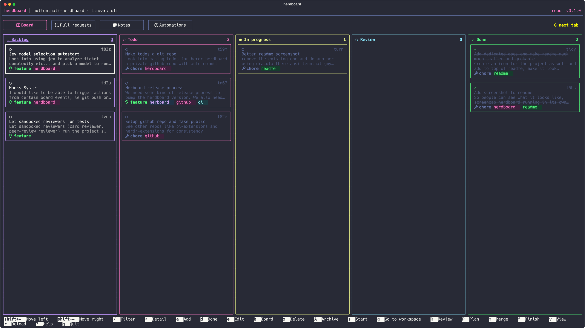

<p align="center">
  
</p>

<h1 align="center">herdboard</h1>

<p align="center">A kanban board inside Herdr for your todos and your Linear issues.<br>A card can start an agent, and herdboard reviews and merges its work.</p>

<p align="center">
  
</p>

---

Todos are plain files. Each board is a folder in `~/todos`, and each card is a folder with a Markdown file. Linear issues show on the same board, in the same columns, with the same commands.

Press `s` on a card and herdboard opens a Git worktree for it, then hands the card to Claude Code, pi or Codex. When the agent is done, you review the work in Hunk or with a second agent. herdboard then merges it locally or opens a draft GitHub pull request, and cleans up.

## Install

You need Herdr 0.9 or later, `uv`, and Python 3.11 or later. To start work on a card, you also need Claude Code, pi or Codex.

```bash
herdr plugin install Nulluminati/herdboard
uv tool install "git+https://github.com/Nulluminati/herdboard"
npx skills add Nulluminati/herdboard@herdboard -g -y
```

To work on herdboard itself, link a clone instead of the first two commands:

```bash
git clone https://github.com/Nulluminati/herdboard.git ~/Projects/herdboard
herdr plugin link ~/Projects/herdboard
uv tool install -e ~/Projects/herdboard
```

The board pane runs through `uv` from the plugin folder, so it works without the `herdboard` command. Agents need the command on the path.

Bind the board to a key in `~/.config/herdr/config.toml`:

```toml
[[keys.command]]
key = "prefix+shift+b"
type = "plugin_action"
command = "nulluminati.herdboard.board"
description = "herdboard: open the kanban board"
```

The key opens the board as a Herdr tab in the focused pane's directory, so the board shows that repository.

Optional tools:

- The hunkdiff Herdr plugin (`jhochenbaum.hunkdiff`), for review in Hunk
- The GitHub CLI (`gh`), signed in, for pull requests
- Hunk 0.23 or later with the `hunk-gh-review` extension, for pull request reviews

### Update

When a newer release exists, the board header shows `↑ update` after the version. Run:

```bash
herdboard update
```

It installs the latest release tag for the Herdr plugin and the `herdboard` command. Reopen the board after it. In a linked clone, run `git pull` in the clone instead. Set `HERDBOARD_NO_UPDATE_CHECK=1` to stop the board from asking GitHub at start.

## Quick start

1. Open a terminal in a repository, inside Herdr.
2. Run `herdboard list`. The command creates the repository board and asks for its settings.
3. Run `herdboard add "Fix login timeout"`. The command prints the card ID, for example `t3m9`.
4. Press the board key. Select the card and press `s`. herdboard creates the worktree and branch `t3m9-fix-login-timeout`, and starts the agent with the card as its brief.
5. When the agent moves the card to Review, press `R` to review the work.
6. Press `m` to merge, then confirm with `y`.

Press `?` on the board for every key.

## Documentation

| Page | What it covers |
|---|---|
| [The board](docs/board.md) | Board setup, keys, mouse, views, triage, card types, the archive and the card markers |
| [Work on a card](docs/work-on-a-card.md) | Plan, start, review, merge and finish a card; mockups, attachments, the log and the details pane |
| [Factory runs](docs/factory-runs.md) | Chain the planner, the builder, lens reviewers and an approver |
| [Workflow verification](docs/workflow-verification.md) | The verification contract that a factory run checks |
| [Agent permissions](docs/agent-permissions.md) | What each agent role may do, and the reviewer sandbox |
| [Pull request reviews](docs/pull-request-reviews.md) | Have an agent review an open GitHub pull request in Hunk |
| [Notes](docs/notes.md) | The scratchpad tab |
| [Automations](docs/automations.md) | Cards that an agent starts on a schedule |
| [Linear](docs/linear.md) | The API key, linked projects, pinned issues, states and `promote` |
| [Commands](docs/commands.md) | Every `herdboard` command, `migrate` and `doctor` |
| [Configuration](docs/configuration.md) | `config.toml`, the configuration dialog, thinking levels and icons |
| [Board files](docs/files.md) | The file format, the state folder and how herdboard writes |
| [Releasing](docs/releasing.md) | How a maintainer cuts a release: the skill, `bin/release.py` and the Release workflow |

## Known limits

- Claude and Codex can show a folder trust prompt in an unfamiliar worktree. Answer it in the agent, reviewer, writer or planner pane. herdboard does not pre-trust folders.
- In Claude's default permission mode, the card's agent asks once before it writes the pull request description in the state folder.
- herdboard does not sync between machines.

## Agent skill

`skills/herdboard/SKILL.md` teaches Claude, pi and Codex to use the CLI with `--json`. It lists the error codes.

## Development

```bash
uv run pytest -n auto
```

Run it from the repository root. `tests/unit` holds the fast tests and `tests/ui` the Textual pilot tests. The tests use fake `herdr`, `gh` and Linear servers. Behavior that depends on Herdr, the agents or GitHub needs a live test with a throwaway repository. [docs/linear-live-test.md](docs/linear-live-test.md) is the checklist for the real Linear API.
